# LeetPilot ⚡
### All-in-One LeetCode Assistant, Socratic Hint Engine & Interview Suite
*Master algorithmic problem solving without spoiler-dumps or ban risks.*

[](LICENSE)
[](https://developer.chrome.com/docs/extensions/mv3/intro/)
[](#features)
[](#4-tier-progressive-hint-engine)

---

## 📌 Overview

**LeetPilot** is an end-to-end technical interview preparation and in-browser assistance suite engineered for candidates preparing for tier-1 engineering interviews across top tech companies.

Unlike aggressive "auto-solve" bots that copy-paste solutions and risk account bans, LeetPilot is built around a **Socratic learning model**:
- It gives progressive, tier-by-tier hints without giving away the full answer.
- It tests your ability to think under pressure using a **45-minute Mock Interview Timer with Strict Mode**.
- It provides a **Manifest V3 Chrome Extension** that injects a floating co-pilot directly into `leetcode.com/problems/*`.
- It includes a **standalone Web Studio** and an **Offline CLI Test Runner** for local algorithmic benchmarking.


---

## 🏛️ System Architecture

```mermaid
graph TD
    subgraph Browser_Extension [Manifest V3 Extension]
        LC[LeetCode Problem Page] --> FloatingPill[Floating Co-Pilot Trigger]
        FloatingPill --> Overlay[Slide-Over Glass HUD]
        Overlay --> TieredHints[4-Tier Socratic Hint System]
    end

    subgraph Standalone_Studio [LeetPilot Web Studio]
        Catalog[Curated Pattern Catalog: Blind 75] --> ProblemView[Problem Specifications & Constraints]
        ProblemView --> Editor[In-Browser Code Editor]
        Editor --> TestHarness[Local Test Case Evaluator]
        TestHarness --> Benchmarks[Execution Latency & Memory Diffs]
        ProblemView --> Timer[45-min Interview Countdown + Strict Mode]
    end

    subgraph Local_CLI [Offline Test Runner]
        PyRunner[leetpilot.py CLI] --> Templates[Language Templates: C++ / Python / Java]
        Templates --> Assertions[Unit Test Assertions & Benchmarking]
    end
```



---

## 💡 4-Tier Progressive Hint Engine

To train real interview communication without spoon-feeding answers, LeetPilot reveals clues sequentially:

1. **Tier 1: Intuition & Analogy** — High-level conceptual perspective (*"Notice that the array is already sorted..."*).
2. **Tier 2: Complexity & Data Structure Clue** — Target Big-O bounds and optimal data structure selection (*"$O(N)$ time with a Hash Map"*).
3. **Tier 3: Pseudocode & Edge Cases** — Structured algorithmic steps and potential pitfalls (*"Handle empty strings and duplicate values"*).
4. **Tier 4: Optimal Solution Blueprint** — Complete annotated implementation and trade-off analysis.

---

## 📦 What's Inside

```
leetpilot/
├── README.md               # Architecture, specification & guide
├── extension_demo/         # Manifest V3 Chrome Extension source
│   ├── manifest.json       # Manifest V3 specification
│   ├── content_demo.js     # Floating co-pilot injection script
│   └── content.css         # Glassmorphic slide-over HUD styling
└── test_runner_demo.py     # Standalone local test runner with timing
```

---

## 🚀 Quick Start

### 1. Run the Local Test Runner Demo
```bash
python test_runner_demo.py
```

### 2. Load the Chrome Extension (Manifest V3)
1. Open `chrome://extensions/` in Chrome, Edge, or Brave.
2. Enable **Developer mode** (toggle in the top-right).
3. Click **Load unpacked** and select the `extension_demo` folder.
4. Open any problem on LeetCode to see the floating assistant in action!

---

<div align="center">
  <b>Architected by MD. Raisul Islam Mobin</b> • <a href="https://mobin.tech">mobin.tech</a>
</div>
